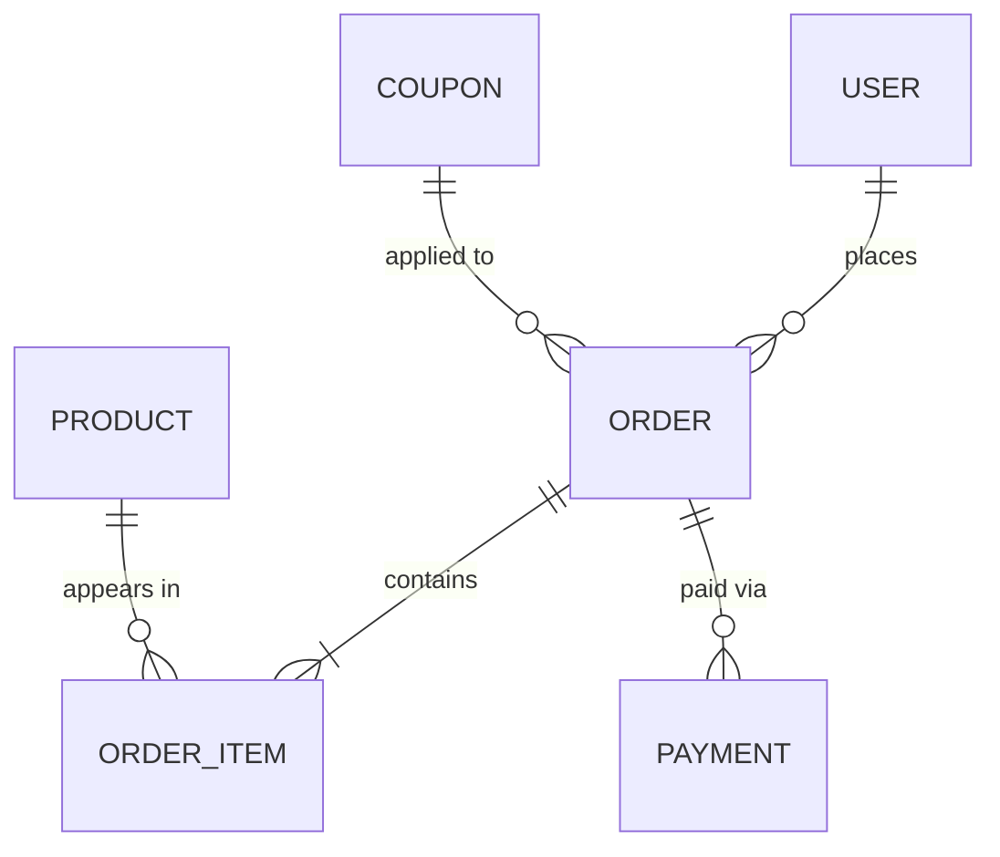

# E-Commerce Admin Panel — Technical Documentation

This document describes **only** what is actually implemented in this repository.
Nothing here is aspirational or fabricated.

---

## 1. Technology Stack

| Layer     | Technology |
|-----------|------------|
| Frontend  | React 19, Vite 7, Tailwind CSS 3, Axios, React Router 7, Recharts, lucide-react |
| Backend   | Java 17, Spring Boot 3.4, Spring Security, JJWT 0.11.5, Spring Data JPA, Bean Validation, Maven |
| Database  | MySQL (production), H2 in-memory (tests) |

---

## 2. Source Layout

```
ecomAlmostdone/
├── reactapp/                 # React frontend
│   └── src/
│       ├── auth/             # Login, Register
│       ├── components/       # Admin + shared components (ProductList, OrderList, Analytics, Insights, Profile, UserList, ...)
│       ├── Dashboard/        # AdminDashboard, UserDashboard (each owns its nested routes)
│       ├── UserComponents/   # Customer-facing pages (UserProductList, PlaceOrder, UserOrderList, UserOrderItem)
│       └── utils/api.js      # Single Axios instance + JWT interceptor + all API functions
└── springapp/                # Spring Boot backend
    └── src/main/java/com/examly/springapp/
        ├── config/           # SecurityConfig, CorsConfig
        ├── controller/       # REST controllers
        ├── dto/              # Request/response DTOs
        ├── exception/        # GlobalExceptionHandler
        ├── model/            # JPA entities
        ├── repository/       # Spring Data repositories
        ├── service/          # Business + analytics + ML services
        └── utils/            # JwtUtil, JwtAuthFilter
```

---

## 3. Database Design

### Entities actually implemented
- **User** — id, email(unique), password(BCrypt, write-only), name, role(USER/ADMIN), active, createdAt, lastLogin
- **Product** — id, name, description, price, category, stockQuantity, imageUrl
- **Order** — id, customerName, customerEmail, shippingAddress, orderDate, status, userId, totalAmount, couponCode, discountAmount
- **OrderItem** — id, product(FK), order(FK), quantity, priceAtPurchase
- **Coupon** — id, code(unique), discountType(PERCENTAGE/FIXED), discountValue, minOrderAmount, maxDiscount, expiryDate, usageLimit, usedCount, active
- **Payment** — id, orderId, amount, method(MOCK), status(PENDING/SUCCESS/FAILED), transactionRef, invoiceNumber, createdAt
- **AuditLog** — id, timestamp, actor, action, entity, entityId, result, details

### ER diagram (Mermaid)

> Note: `Order.userId` is a plain FK column (nullable for legacy rows created before the column existed). `Coupon → Order` is a soft link via `Order.couponCode`.

---

## 4. Authentication & Authorization

- Login: `POST /auth/login` → verifies BCrypt password, returns JWT (HS256) containing `sub`=email, `role`, `userId`, with expiry (`jwt.expirationMs`).
- `JwtAuthFilter` validates the Bearer token and populates the `SecurityContext` with `ROLE_<role>`.
- `GET /auth/me` returns the authenticated user's profile (resolved from JWT; password never serialized).
- Admin accounts: `POST /auth/register/admin` is `@PreAuthorize("hasRole('ADMIN')")` — only an existing admin can create admins.
- Passwords are hashed with `BCryptPasswordEncoder` and marked `@JsonProperty(WRITE_ONLY)`.

### Authorization matrix (verified by `SecurityIntegrationTest`)
| Endpoint group | ADMIN | USER | Anonymous |
|----------------|:-----:|:----:|:---------:|
| `POST /auth/login`, `POST /auth/register` | ✓ | ✓ | ✓ |
| `GET /api/products/**` | ✓ | ✓ | ✓ |
| `POST/PUT/DELETE /api/products/**` | ✓ | ✗ (403) | ✗ (401/403) |
| `GET /api/users/**` | ✓ | ✗ (403) | ✗ (401) |
| `/api/analytics|rfm|forecast|demand|risk|audit/**` | ✓ | ✗ (403) | ✗ (401) |
| `GET/POST/DELETE /api/coupons` | ✓ | ✗ (403) | ✗ (401) |
| `POST /api/coupons/validate` | ✓ | ✓ | ✗ (401) |
| `/api/orders/**` | ✓ | ✓ (own only) | ✗ (401) |
| `/api/payments/**`, `/api/recommendations` | ✓ | ✓ (own only) | ✗ (401) |

Ownership is always resolved from the JWT `userId`, never from a client-supplied value.

---

## 5. REST API Summary

**Auth**: `POST /auth/login`, `POST /auth/register`, `POST /auth/register/admin`, `GET /auth/me`

**Products**: `GET /api/products?category=&minPrice=&maxPrice=`, `GET /api/products/{id}`, `POST/PUT/DELETE /api/products[/{id}]` (admin)

**Orders**: `POST /api/orders`, `GET /api/orders` (admin), `GET /api/orders/my`, `GET /api/orders/my/{id}`, `GET /api/orders/{id}` (admin), `PATCH /api/orders/{id}/status` (admin), `PATCH /api/orders/{id}/cancel`, `DELETE /api/orders/{id}` (admin)

**Users**: `GET /api/users`, `GET /api/users/{id}`, `PUT /api/users/{id}`, `DELETE /api/users/{id}` (admin)

**Analytics / ML**: `GET /api/analytics/summary`, `GET /api/rfm/segments`, `GET /api/recommendations`, `GET /api/forecast?days=&historyDays=`, `GET /api/demand`, `GET /api/risk/orders`, `GET /api/audit`

**Coupons**: `POST /api/coupons/validate`, `GET/POST /api/coupons`, `DELETE /api/coupons/{id}`

**Payments**: `POST /api/payments`, `GET /api/payments/order/{orderId}`, `GET /api/payments/invoice/{orderId}`

---

## 6. Order & Inventory Flow

```
Cart/Checkout (frontend)
        ↓
POST /api/orders  (customerName, customerEmail, shippingAddress, orderItems[], couponCode?)
        ↓  (server-side, single @Transactional method)
Validate quantity > 0                     → 400 on failure
Load product                              → 400 "Product not found"
Check stock >= quantity                   → 400 "Insufficient stock for product: X"
Deduct stock exactly once (server)        → productRepository.save
Compute subtotal from DB prices
Apply coupon (if supplied, validated)     → discount
totalAmount = subtotal - discount
Persist order + items
        ↓
201 Created
```
Stock is deducted **only** on the backend; the frontend never calls `updateProduct` after checkout.

**Cancellation** (`PATCH /api/orders/{id}/cancel`, owner only, or admin status update to CANCELLED):
restores stock for each item and sets status CANCELLED — all inside one transaction.
Only `PENDING`/`PROCESSING` orders may be cancelled.

**Order deletion** (admin) restores stock unless the order was already CANCELLED/DELIVERED.

---

## 7. Analytics Methodology (`AnalyticsService`)

All values are aggregated from real DB rows (cancelled orders excluded from revenue):
total revenue, total/completed/cancelled orders, distinct customers, product count,
average order value, 6-month revenue trend, 14-day order trend, category sales,
top-5 products, low-stock (≤10) products, and order-status distribution.
A fetch-join query (`findAllWithItems`) avoids N+1 access.

## 8. RFM Methodology (`RfmService`)

- Group non-cancelled orders per customer (`userId`, else lower-cased email).
- R = days since last order; F = order count; M = total spend.
- Each metric is scored 1–5 by **percentile rank** within the actual population:
  `score = round(f * 4) + 1`, where `f` is the percentile (inverted for recency).
- Deterministic segments: High Value, Loyal, New, Potential Loyal, At Risk, Inactive, Regular.
- Output: per-segment customer count, revenue contribution, average spend.

## 9. Recommendation Methodology (`RecommendationService`)

1. Popularity = total quantity sold per product (non-cancelled).
2. If the user has purchase history → recommend in-stock products from the **same categories** not yet bought.
3. Cold start (no history / no candidates) → globally most popular in-stock products.
4. `score = 0.7 * popularityNorm + 0.3 * stockNorm` (documented in code); falls back to stock when no sales exist.
Each item returns a human-readable `reason`.

## 10. Sales Forecasting (`ForecastService`)

- Build a daily revenue series (default 60 days) from real orders.
- 80/20 train-test split; ordinary-least-squares linear regression (`y = intercept + slope·x`).
- Evaluate with **MAE**, **RMSE**, **MAPE** on the held-out window (only reported when computable).
- Refit on the full series to forecast the next N days.
- If fewer than 5 days of data exist, returns `INSUFFICIENT_DATA` rather than a guess.

## 11. Demand Prediction (`DemandService`)

Per product: `avgDailyDemand = totalSold / salesSpanDays`;
`predictedDemand = avgDailyDemand × LEAD_TIME(14)`; `reorderThreshold = avgDailyDemand × (14+7)`.
Status: Critical / Reorder Recommended / Low Stock / Healthy Stock (no-history uses a threshold of 10).

## 12. Risk / Anomaly Detection (`RiskService`)

Per-order triage (Normal / Review Required) using signals relative to the **same customer's** history:
value > 3× their average order value; single line quantity ≥ 10; ≥ 3 orders within 24h; abnormal cancellations.
Each flag carries a reason. This is a **review-triage tool**, not a fraud determination.

## 13. Coupons & Payments

- Coupons are validated server-side (existence, active, expiry, usage limit, minimum order) and applied inside order creation; the client never sets the discount.
- Payments use a **mock** gateway (no real credentials). Status `PENDING → SUCCESS`. Invoices are generated as JSON with an invoice number, line items, subtotal, discount and INR total.

## 14. Audit Logging (`AuditService`)

Records login (success/failure), product create/update/delete, order status change/cancel/delete, user delete, coupon create/delete — with timestamp, actor, action, entity, entityId, result, details. Passwords/tokens are never logged. Logging failures never break business operations.

## 15. Testing

Every suite runs against **H2 only**; none of them needs a MySQL server.

**Backend** — `cd springapp && ./mvnw test` (36 test classes, 229 tests):
- Security & authorization: `SecurityIntegrationTest`, `JwtSecurityTest`, `CheckoutAuthorizationTest`, `ProductStatsAuthorizationTest`, `PaymentVisibilityTest`, `SecurityHeadersAndCorsTest`, `PasswordPolicyTest`, `ActiveUserLoginTest`, `LoginRateLimitTest`, `LoginRateLimiterTest`.
- Validation & error handling: `ProductValidationTest`, `CouponValidationTest`, `CouponUpdateTest`, `UserControllerValidationTest`, `GlobalExceptionHandlerTest`.
- Pagination, queries & exports: `PaginationApiTest`, `ProductPaginationTest`, `OrderListFetchJoinTest`, `OrderCsvExportTest`, `OrderAnalyticsOptimizationTest`.
- Business logic: `CouponServiceTest`, `PaymentServiceTest`, `MlLogicTest`, `AnalyticsAggregationTest`, `AnalyticsDashboardMetricsTest`, `OrderItemRelationshipTest`, `OrderCouponRestoreTest`, `TransactionalIntegrityConcurrencyTest`.
- Controller smoke tests: `ProductControllerTest`, `OrderControllerTest`.
- Configuration & safety guards: `ProductionConfigurationValidatorTest`, `SafeDatabaseConfigurationTest`, `FlywayTestSafetyGuardTest`, `ActuatorHealthTest`, `ECommerceAdminPanelApplicationTests`.

**Frontend unit/component** — `cd reactapp && npm run test:run` (Vitest + Testing Library, 16 files, 66 tests): `Login`, `Register`, `AdminDashboard`, `Analytics`, `ProductList`, `ProductForm`, `OrderList`, `OrderDetails`, `CreateOrder`, `CouponList`, `UserDetails`, `PrivateRoute`, `UserProductList`, `PlaceOrder`, `UserOrderList`, `UserOrderItem`.

**End-to-end** — `cd reactapp && npm run test:e2e` (Playwright, 2 specs, 7 tests: `e2e/admin.spec.js`, `e2e/auth-and-shopping.spec.js`). Playwright starts Vite plus a backend on the `e2e` profile with H2 seed data; MySQL is never contacted.

**Static checks** — `npm run lint` (ESLint, clean) and `npm run build` (Vite production build).

**CI** — `.github/workflows/quality.yml` runs on every push and pull request: `npm ci`, unit tests, lint and build for the frontend, plus `./mvnw test` for the backend.

## 16. Security Controls

- BCrypt password hashing; password hash never serialized.
- JWT HS256 with configurable secret + expiry; stateless sessions.
- Method-level `@PreAuthorize` + URL rules; JSON 401/403 responses.
- Bean Validation on request DTOs; centralized exception handler (no stack traces leaked).
- Catalogue filter queries parameterised by Spring Data (no string SQL → no injection).
- Secrets via env vars: `DB_URL`, `DB_USERNAME`, `DB_PASSWORD`, `JWT_SECRET`, `JWT_EXPIRATION_MS`, `PORT`.

## 17. Known Limitations / Future Work

- Forecasting uses simple linear regression (no seasonality); accuracy depends on data volume.
- Recommendations are content/popularity based (no collaborative filtering).
- No real payment gateway (mock only).
- Catalogue, order and user listings are **server-paginated**: `GET /api/products/paged`, `/api/orders/paged`, `/api/orders/my/paged` and `/api/users/paged` accept `page`/`size`/`sort` plus filters and (for the catalogue) free-text search, and return totals computed server-side. The legacy array endpoints (`/api/products`, `/api/orders`, ...) are retained for compatibility and are **unbounded**, so they must not be used for large datasets. The UI uses the paged endpoints.
- The default `JWT_SECRET` fallback must be overridden in production (rotate if it was ever exposed).
